	<picture>
		<source srcset="out/topbar-dark.svg" media="(prefers-color-scheme: dark)">
		
	</picture> 
	<a href="https://zoasr-portfolio.pages.dev/">
		<picture>
			<source srcset="out/website-dark.svg" media="(prefers-color-scheme: dark)">
			
		</picture>
	</a> 
	<a href="https://github.com/zoasr">
		<picture>
			<source srcset="out/github-dark.svg" media="(prefers-color-scheme: dark)">
			
		</picture>
	</a> 
	<a href="https://www.linkedin.com/in/zeyad-sherif/">
		<picture>
			<source srcset="out/linkedin-dark.svg" media="(prefers-color-scheme: dark)">
			
		</picture>
	</a>

	<picture>
		<source srcset="out/header-dark.svg" media="(prefers-color-scheme: dark)">
		
	</picture>

	<picture>
		<source srcset="out/work-dark.svg" media="(prefers-color-scheme: dark)">
		
	</picture> 
	<a href="https://lastfm-viewer.vercel.app/">
		<picture>
			<source srcset="out/@lastfm-viewer-dark.svg" media="(prefers-color-scheme: dark)">
			
		</picture>
	</a> 
	<a href="https://github.com/zoasr/oversec-stego">
		<picture>
			<source srcset="out/oversec-stego-dark.svg" media="(prefers-color-scheme: dark)">
			
		</picture>
	</a> 
	<a href="https://clinic-run-demo.vercel.app">
		<picture>
			<source srcset="out/clinic-run-dark.svg" media="(prefers-color-scheme: dark)">
			
		</picture>
	</a> 
	<a href="https://supa-shop.cloudflare-untying955.workers.dev">
		<picture>
			<source srcset="out/supa-shop-dark.svg" media="(prefers-color-scheme: dark)">
			
		</picture>
	</a> 
	<a href="https://fav-tv.vercel.app">
		<picture>
			<source srcset="out/fav-tv-dark.svg" media="(prefers-color-scheme: dark)">
			
		</picture>
	</a> 
	<a href="https://machlist.vercel.app/">
		<picture>
			<source srcset="out/machlist-dark.svg" media="(prefers-color-scheme: dark)">
			
		</picture>
	</a> 
	<picture>
		<source srcset="out/also-dark.svg" media="(prefers-color-scheme: dark)">
		
	</picture> 
	<!--<a href="https://github.com/zoasr/lastfm-ts-api">
		<picture>
			<source srcset="out/lastfm-ts-api-dark.svg" media="(prefers-color-scheme: dark)">
			
		</picture>
	</a> -->
	<a href="https://github.com/zoasr/task-manager-expo">
		<picture>
			<source srcset="out/task-manager-expo-dark.svg" media="(prefers-color-scheme: dark)">
			
		</picture>
	</a> 
	<a href="https://github.com/zoasr/p5-sketches">
		<picture>
			<source srcset="out/p5-sketches-dark.svg" media="(prefers-color-scheme: dark)">
			
		</picture>
	</a> 
	<a href="https://github.com/zoasr/processing-sketches">
		<picture>
			<source srcset="out/processing-sketches-dark.svg" media="(prefers-color-scheme: dark)">
			
		</picture>
	</a> 
	<a href="https://github.com/zoasr/libmatrix">
		<picture>
			<source srcset="out/libmatrix-dark.svg" media="(prefers-color-scheme: dark)">
			
		</picture>
	</a> 
	<a href="https://cryptofix-landing.vercel.app">
		<picture>
			<source srcset="out/cryptofix-landing-dark.svg" media="(prefers-color-scheme: dark)">
			
		</picture>
	</a>

